<h1 align="left">Olá, eu sou o David 👋</h1>

### Desenvolvedor Backend Java · Spring Boot · PostgreSQL

Estudante de **Análise e Desenvolvimento de Sistemas (UNIBRA)**, formado em **Ciências Contábeis** e há 4 anos na área financeira e de contratos de uma imobiliária, onde gerencio cerca de **300 contratos**. Hoje levo essa visão de negócio para o backend: construo APIs com **regras de domínio reais, segurança e testes**, não só CRUD.

🎯 **Procurando meu primeiro estágio em desenvolvimento backend** · 📍 Recife, PE (Porto Digital) · presencial, híbrido ou remoto

  
  

---

## 🚀 Projetos em destaque

| Projeto | O que é | Destaques técnicos |
|---|---|---|
| **[registro-corista-api](https://github.com/DavidLimm/registro-corista-api)** | API de gestão da mocidade de uma igreja com **13 congregações** — cliente real, em uso | Java 21 · Spring Boot 4 · **JWT + RBAC** por permissão · Flyway · erros em **RFC 7807** · **Testcontainers** · regras de **LGPD** para menores |
| **[amigos-do-nordeste-api](https://github.com/swetonyancelmo/amigos-do-nordeste-api)** | Backend do cadastro de famílias atendidas por uma **ONG no Sertão do Moxotó (PE)** — projeto em equipe | Spring Boot · PostgreSQL · Flyway · relatórios em Excel · ADRs · deploy no Render · fluxo Kanban |
| **[orderms](https://github.com/DavidLimm/orderms_desafio_backend_btg)** | Microsserviço de pedidos do **Desafio Engenheiro de Software — BTG Pactual** | Arquitetura orientada a eventos · **RabbitMQ** · **MongoDB** · Docker Compose · OpenAPI |
| **[CommunityLab](https://github.com/No-Country-simulation/G10-BRASIL-Equipe-14)** | MVP que transforma discussões de comunidades técnicas em conteúdo estruturado — **Hackathon ONE (Oracle)** | IA + curadoria humana (*human-in-the-loop*) · **n8n** · Python · Oracle Cloud (OCI) · trabalho em equipe |
| **[Date Finder Recife](https://github.com/DavidLimm/agent_date_recife)** · [🔗 demo](https://agentdaterecife-blxbnkyymph8gp8zt3s4xu.streamlit.app/) | Agente de IA que recomenda lugares em Recife com base em acervo próprio | **RAG** · LangChain · Gemini · ChromaDB · Streamlit · **publicado online** |
| **[academysystem](https://github.com/DavidLimm/academysystem)** | API de gestão de academia | Spring Security · JWT · autorização por roles · paginação · Swagger · Docker |

---

## 🛠️ Stack

**Backend:** Java 21 · Spring Boot (Web, Data JPA, Security, Validation, AMQP) · JWT · Flyway · Maven 
**Dados & mensageria:** PostgreSQL · MongoDB · RabbitMQ 
**Testes & qualidade:** JUnit 5 · Mockito · Testcontainers 
**DevOps:** Docker · Docker Compose · Git/GitHub · GitHub Actions 
**IA & automação:** LangChain · RAG · Spring AI · n8n · Python 
**Também uso:** TypeScript · Node.js · Postman · Swagger/OpenAPI

  

---

## 📚 Estudando agora

Microsserviços com Kafka e RabbitMQ · Kubernetes e cloud · estruturas de dados · sistemas agênticos com LLMs

---

## 📊 GitHub

  

<picture>
  <source media="(prefers-color-scheme: dark)" srcset="https://raw.githubusercontent.com/DavidLimm/DavidLimm/pacman-output/pacman-contribution-graph-dark.svg">
  <source media="(prefers-color-scheme: light)" srcset="https://raw.githubusercontent.com/DavidLimm/DavidLimm/pacman-output/pacman-contribution-graph.svg">
  
</picture>
